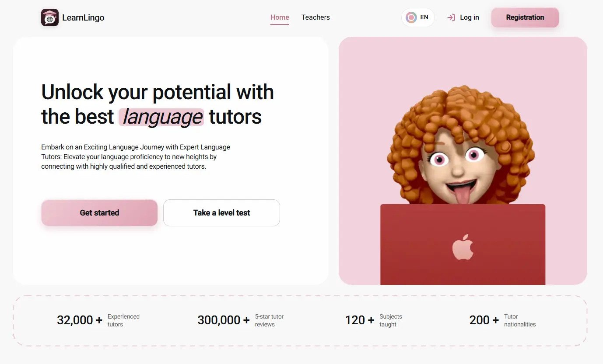
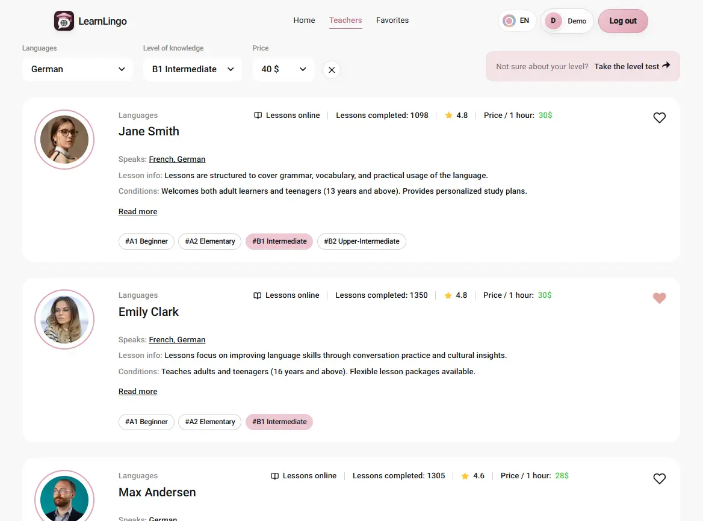
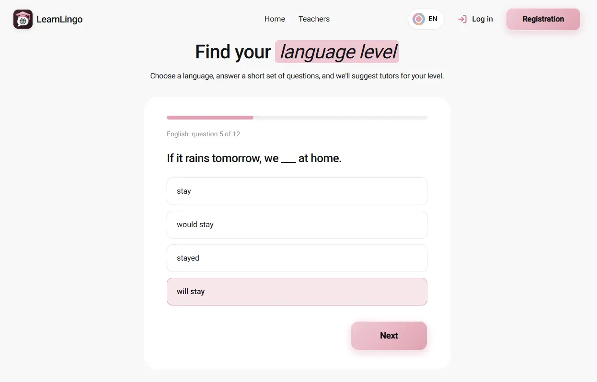
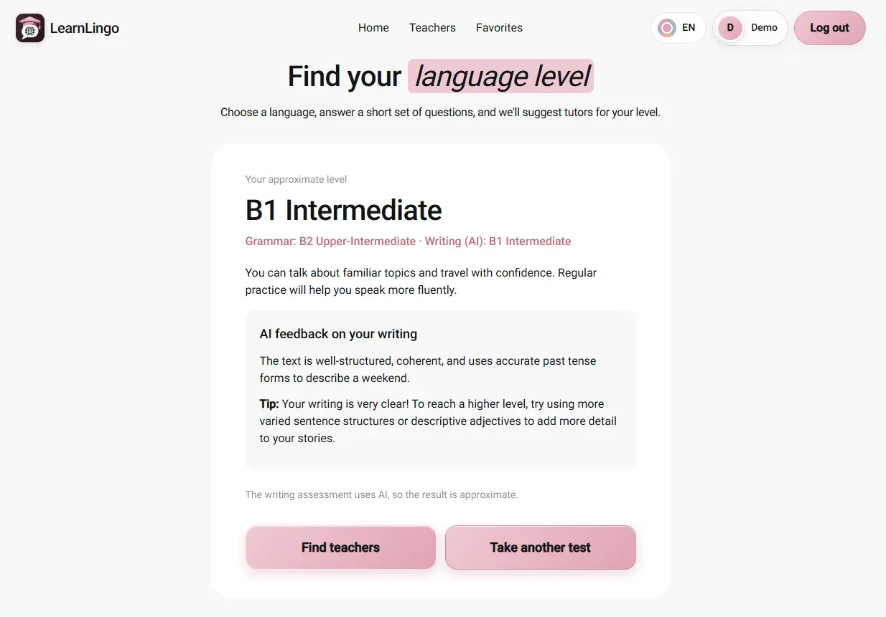
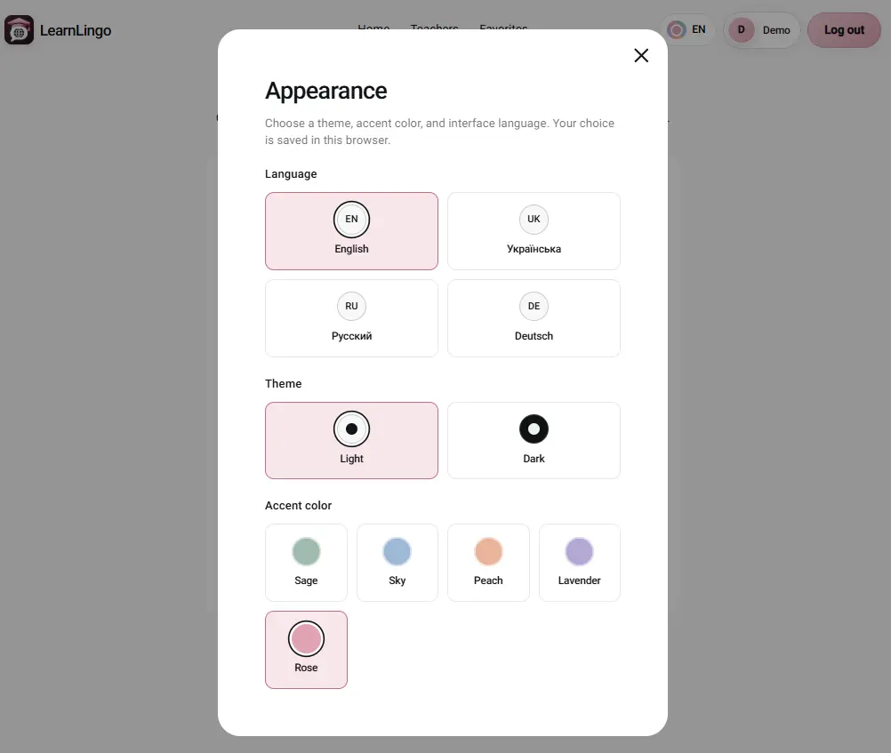
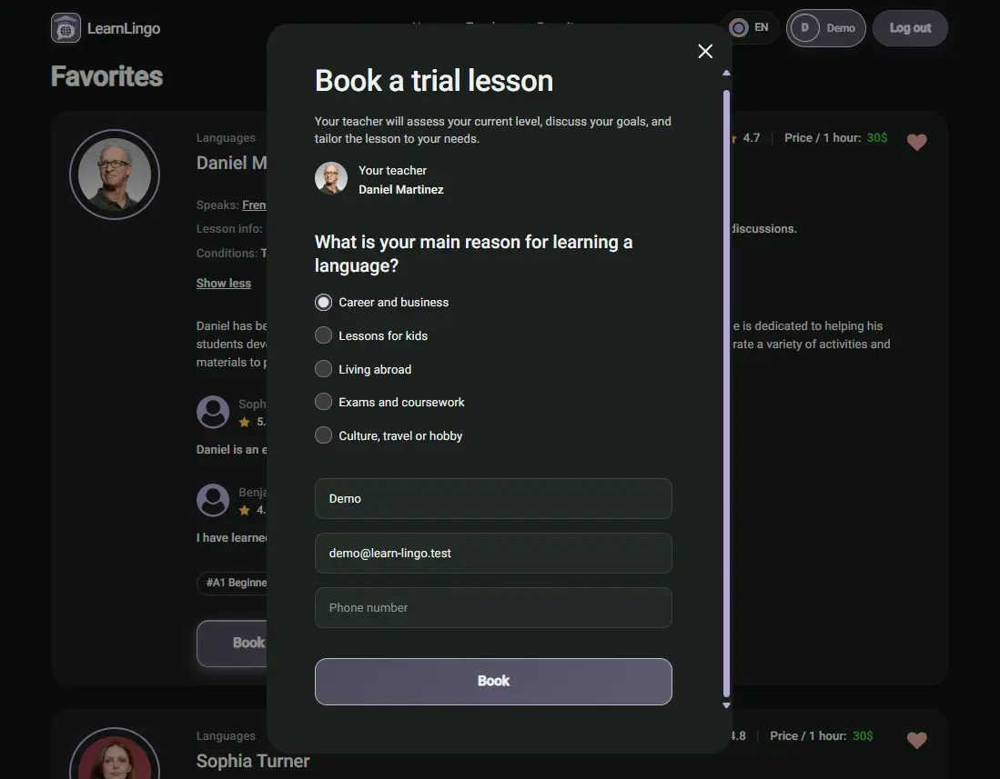
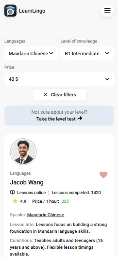

<div align="center">

# 🌍 Learn Lingo

**Find your perfect language tutor, check your level and book a trial lesson in a few clicks.**

[](https://learn-lingo-one-delta.vercel.app)
[](https://www.figma.com/file/dewf5jVviSTuWMMyU3d8Mc/%D0%9F%D0%B5%D1%82-%D0%BF%D1%80%D0%BE%D1%94%D0%BA%D1%82-%D0%B4%D0%BB%D1%8F-%D0%9A%D0%A6?type=design&node-id=0-1&mode=design&t=jCmjSs9PeOjObYSc-0)
[](https://docs.google.com/document/d/1ZB_MFgnnJj7t7OXtv5hESSwY6xRgVoACZKzgZczWc3Y/edit?tab=t.0)


</div>

---

## 📑 Table of Contents

- [About](#-about)
- [Demo Account](#-demo-account)
- [Screenshots](#-screenshots)
- [Features](#-features)
- [Tech Stack](#-tech-stack)
- [Notes on the Assignment](#-notes-on-the-assignment)
- [Key Decisions](#-key-decisions)
- [AI Features](#-ai-features)
- [Internationalization](#-internationalization)
- [Security](#-security)
- [Project Structure](#-project-structure)
- [Getting Started](#-getting-started)
- [Roadmap](#-roadmap)
- [AI Assistance](#-development-process--ai-assistance)
- [Author](#-author)

---

## 📖 About

Learn Lingo is a responsive web application for finding language tutors and booking trial lessons. Users can browse tutors, filter them by language, level and price, save favorites, take a level test with AI feedback on their writing, and use the interface in four languages with light and dark themes.

The project started as a course assignment (see [Notes on the Assignment](#-notes-on-the-assignment)) and grew into a full-stack Next.js application with Firebase and the Gemini API.

---

## 🔑 Demo Account

Want to try the app without registering? Log in with:

- **Email:** `demo@learn-lingo.test`
- **Password:** `Demo12345`

The password of the demo account cannot be changed from the profile.

---

## 🖼️ Screenshots

<p align="center">
  
  
</p>

<p align="center">
  
  
</p>

<p align="center">
  
  
</p>

<p align="center">
  
  
</p>

---

## ✨ Features

**Tutors**
- 👩‍🏫 Tutor catalog with detailed cards: experience, lesson info, conditions and student reviews
- 🔍 Filters by language, proficiency level and hourly price, synced with the URL (shareable links, working back/forward buttons)
- ➕ "Load more" in batches of four
- ❤️ Favorites stored in Firestore with optimistic updates and rollback on error, plus a private Favorites page
- 📅 Trial lesson booking with a validated form

**Accounts**
- 🔐 Email and password registration and login
- 🔓 Google sign-in
- 📧 Password reset by email and password change with re-authentication
- 👤 Profile editing: display name and avatar upload (Cloudinary)

**Level test**
- 🎯 12-question test for English, German and French with an approximate level from A1 to C2
- 🤖 Optional writing task with AI feedback (CEFR estimate, up to three corrected mistakes, a tip)
- 🔗 One click to the catalog with the language and level filters already applied (falls back to the language only if no tutor matches the level)

**Interface**
- 🌐 UI in English, Ukrainian, Russian and German
- 🗣️ Tutor descriptions and reviews translated once with Gemini and stored in Firestore
- 🌗 Light and dark themes and five accent colors
- ⚡ Skeleton loading states, favorites prefetch on navigation hover and focus, scroll-to-top button, toast notifications
- 👀 Interactive hero animation (eyes follow the cursor, blinking, a wink on click)
- ♿ Keyboard-friendly controls, ARIA attributes, focus management in modals and in the test

---

## 🛠️ Tech Stack

| Area                   | Tools & Libraries                                                |
| :--------------------- | :--------------------------------------------------------------- |
| Framework & Language   | Next.js 16 (App Router, Cache Components), React 19, TypeScript  |
| Compiler               | React Compiler                                                   |
| Styling                | CSS Modules, design tokens (CSS variables), `clsx`               |
| Server State & Caching | TanStack Query                                                   |
| Auth & Database        | Firebase Authentication, Cloud Firestore                         |
| Server-side Firebase   | `firebase-admin` (route handler only)                            |
| AI                     | Gemini API                                                       |
| Media Storage          | Cloudinary                                                       |
| Forms & Validation     | React Hook Form, Yup                                             |
| Notifications          | React Toastify                                                   |
| Animation              | Lottie (`lottie-react`)                                          |

---

## 📋 Notes on the Assignment

The original assignment asks for three pages (Home, Teachers, private Favorites), authentication, filters, favorites, a booking form and a Realtime Database collection of tutors. A few decisions differ from the letter of the assignment:

- **Firestore instead of Realtime Database:** richer querying and subcollections (`users/{uid}/favorites`).
- **Next.js App Router instead of React Router:** routing is handled by the framework (`/`, `/teachers`, `/favorites`, `/level-test`).
- **Favorites** are stored in Firestore, so they persist after a page reload and across devices.
- **Everything beyond the assignment** (level test, AI feedback, localization, themes, Google sign-in, password management) is an extension and does not replace any required behavior.

---

## 🧠 Key Decisions

- **TanStack Query for server state:** fetching, caching and invalidation, including infinite loading for tutors and favorites.
- **Optimistic updates with rollback:** `onMutate` cancels in-flight queries and updates the cache immediately; `onError` restores the snapshot and shows a toast.
- **Server prefetch and hydration:** the Teachers page prefetches the first page on the server and hydrates it on the client.
- **URL as the source of truth for filters:** the filter state is synced with the address bar, so links, reloads and navigation behave predictably.
- **Server vs. Client Components:** interactive parts live in `'use client'` components; data fetching for the catalog is prefetched on the server.
- **Design tokens and theming:** all colors are CSS variables; accent palettes and the dark theme override a small set of tokens, and derived colors are computed with `color-mix`. The saved theme is applied before the first paint by a tiny inline script, so the page does not flash.
- **Schema-based validation:** React Hook Form with Yup, with translatable error messages.
- **Resilient loading states:** route-level skeletons and per-component fallbacks instead of a global spinner.

---

## 🤖 AI Features

AI feedback in the level test is the only part of the app that calls an external AI API, so it is built defensively:

- **Server-only calls:** the browser sends the text to a route handler (`app/api/assess`). The Gemini API key never reaches the client.
- **Authenticated and limited:** requests must carry a Firebase ID token, which is verified on the server with the Admin SDK. Each user gets a small daily quota (counted in Firestore, refunded if the AI call fails). Text length is limited.
- **Structured and validated output:** the model is asked for JSON that matches a schema, and the response is validated again on the server. Levels must be one of the six CEFR values; the number and length of mistakes are capped.
- **Prompt-injection aware:** the user text is treated as data only, and the instructions say so explicitly.
- **Graceful fallback:** if the AI is unavailable or the quota is reached, the user can skip the step and still get the grammar result.
- **Feedback language:** the summary, explanations and tip are written in the current UI language.

> The free Gemini tier may use submitted content to improve Google products, so the UI asks users not to include personal data in the text.

---

## 🌐 Internationalization

- **Client-side i18n without extra dependencies:** typed dictionaries for `en` (source of truth), `uk`, `ru` and `de`. A missing or extra key is a TypeScript error. The selected language is stored in `localStorage` and applied before hydration.
- **Plurals and interpolation** are supported (`Intl.PluralRules` for Ukrainian and Russian forms).
- **Data labels:** language names use `Intl.DisplayNames`; CEFR level names are translated with a dictionary. Filter values and URL parameters stay in English.
- **Tutor profiles:** descriptions, conditions, experience and reviews are translated once with Gemini and stored in `teachers/{id}.translations`. English is used as a fallback.
- **Limitations:** page metadata stays in English, and the URL does not contain the language (no `/uk/...` routes). Translations were machine-generated, and the German texts have not been reviewed by a native speaker.

---

## 🔒 Security

- **Firestore rules** live in [`firestore.rules`](./firestore.rules): tutors are read-only, user data and favorites are readable and writable only by the owner, and bookings can only be created with a validated set of fields.
- **Secrets:** the Admin SDK credentials and the Gemini key are server-side environment variables without the `NEXT_PUBLIC_` prefix. `.env*` files are ignored by git.
- **Authentication errors** are mapped to friendly messages, and password reset does not reveal whether an account exists.

---

## 📂 Project Structure

```text
.
├── app/            # Pages, layouts, error boundaries, API route (app/api/assess)
├── components/     # UI components, forms, modals, cards, level test
├── contexts/       # Auth context
├── data/           # Level test questions, accents and themes, demo account
├── docs/           # README screenshots
├── hooks/          # Custom hooks (useAuth, useAccent, ...)
├── i18n/           # Dictionaries, useT hook, data label helpers
├── lib/            # Firebase client and admin initialization, helpers
├── providers/      # TanStack Query and Auth providers
├── services/       # Firebase, Cloudinary and Firestore service functions
├── types/          # TypeScript types
├── public/         # Static assets
├── scripts/        # One-off maintenance scripts (optional)
└── firestore.rules
```

---

## 🚀 Getting Started

### Prerequisites

- Node.js 20+
- npm
- A Firebase project (Authentication with Email/Password and Google, Firestore)
- A Cloudinary account (unsigned upload preset)
- A Gemini API key (optional; only needed for the AI writing feedback)

### Installation

```bash
git clone https://github.com/Vl-as/learn-lingo.git
cd learn-lingo
npm install
```

### Environment variables

Create a `.env.local` file in the project root.

| Variable | Scope | Description |
| :-- | :-- | :-- |
| `NEXT_PUBLIC_FIREBASE_API_KEY` | public | Firebase web config |
| `NEXT_PUBLIC_FIREBASE_AUTH_DOMAIN` | public | Firebase web config |
| `NEXT_PUBLIC_FIREBASE_PROJECT_ID` | public | Firebase web config |
| `NEXT_PUBLIC_FIREBASE_STORAGE_BUCKET` | public | Firebase web config |
| `NEXT_PUBLIC_FIREBASE_MESSAGING_SENDER_ID` | public | Firebase web config |
| `NEXT_PUBLIC_FIREBASE_APP_ID` | public | Firebase web config |
| `NEXT_PUBLIC_FIREBASE_MEASUREMENT_ID` | public | Firebase web config |
| `NEXT_PUBLIC_CLOUDINARY_CLOUD_NAME` | public | Avatar uploads |
| `NEXT_PUBLIC_CLOUDINARY_UPLOAD_PRESET` | public | Avatar uploads (unsigned preset) |
| `FIREBASE_CLIENT_EMAIL` | server only | Service account e-mail (Admin SDK) |
| `FIREBASE_PRIVATE_KEY` | server only | Service account private key, keep the `\n` escapes inside quotes |
| `GEMINI_API_KEY` | server only | Gemini API key |
| `GEMINI_MODEL` | server only | Gemini model id used for the AI feedback |

Never commit these values. On Vercel, add the same variables in the project settings and redeploy.

### Firebase setup

1. Enable **Email/Password** and **Google** in Authentication and add your domain to the authorized domains.
2. Create a Firestore database with the collections `teachers` (seeded from the sample data), `users`, `bookings` and, for the AI quota, `aiUsage` (written by the server only).
3. Paste the rules from [`firestore.rules`](./firestore.rules) into the Firestore rules editor and publish them.

### Scripts

| Command         | Description                |
| :-------------- | :------------------------- |
| `npm run dev`   | Start the dev server       |
| `npm run build` | Create a production build  |
| `npm run start` | Run the production build   |
| `npm run lint`  | Lint the code              |

### Translating tutor profiles (optional)

The translations stored in Firestore were generated once with a maintenance script. To regenerate them after adding tutors:

```bash
node --env-file=.env.local scripts/translate-teachers.mjs --dry   # preview the first tutor
node --env-file=.env.local scripts/translate-teachers.mjs         # translate tutors without translations
```

The script skips tutors that already have `translations` (use `--force` to overwrite). Check the output before publishing it.

---

## 🗺️ Roadmap

- [ ] Sorting tutors by price, rating and lessons completed
- [ ] Server-side pagination for large tutor collections
- [ ] Tutor profile pages with their own links and metadata
- [ ] Locale-prefixed routes for better SEO
- [ ] Automated tests and CI
- [ ] Real-time calendar slot selection for trial lessons

---

## 🤝 Development Process & AI Assistance


I built this project with the help of AI tools and used them as assistants, not as a replacement for my own work:

- **Claude (Anthropic):** planning features, code review, drafting implementations and debugging. It helped with the level test, the AI assessment route, theming, password management, the localization approach and the documentation.
- **GitHub Copilot:** in-editor completions and agent mode for repetitive, project-wide changes, for example moving UI strings into translation dictionaries.

What I did myself: defined the scope and the stack, reviewed and adjusted the generated code, tested every feature in the browser, configured Firebase, Cloudinary, Gemini and Vercel, and fixed the issues found along the way.

> The Gemini API used inside the app (writing feedback and tutor translations) is a product feature and is described in [AI Features](#-ai-features); it is separate from the tools above.

---

## 👨‍💻 Author

**Volodymyr Asieiev**

[](https://github.com/Vl-as)
[](https://linkedin.com/in/volodymyr-asieiev)
[](https://t.me/vasvv)
